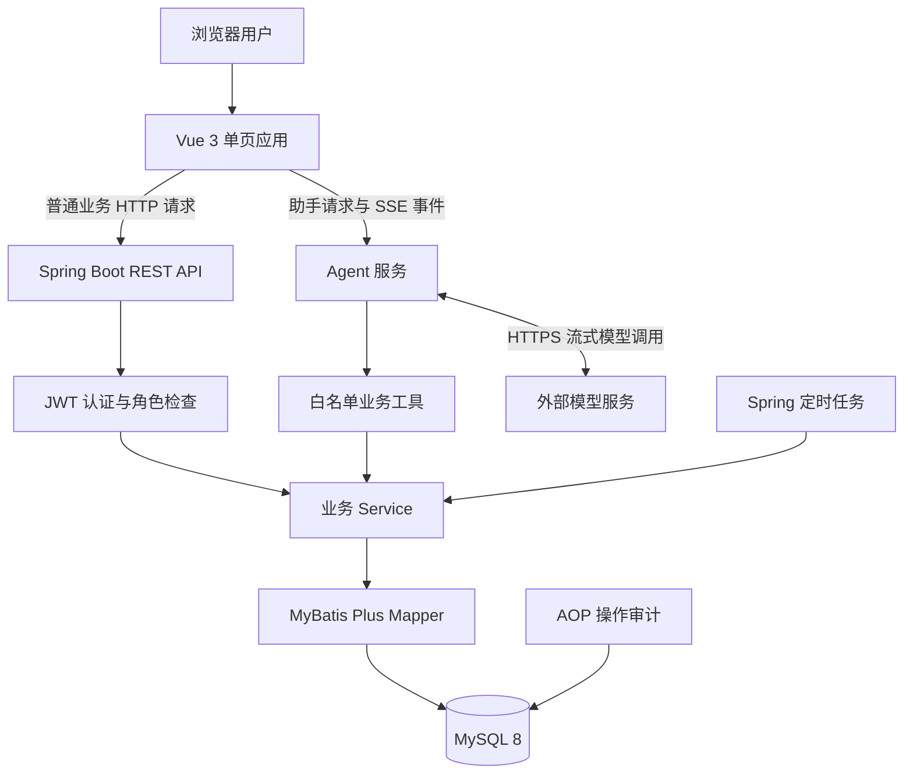
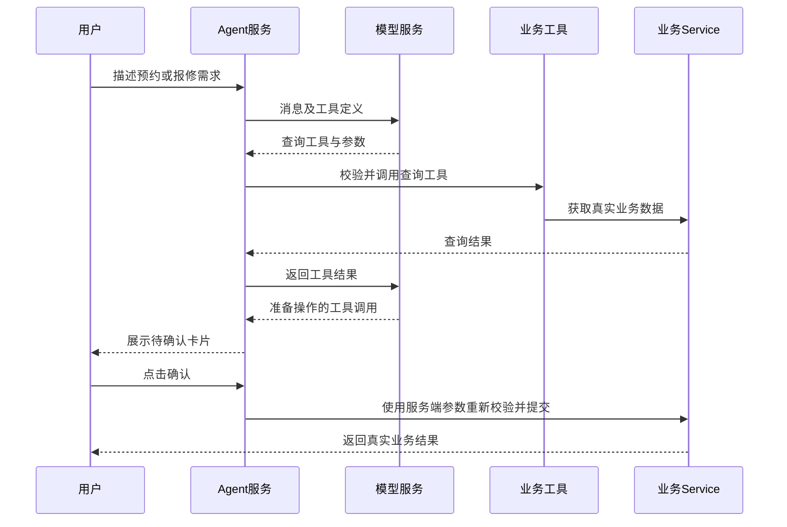

# 高校实验室预约与设备运维系统技术架构与技术选型说明

编写日期：2026年11月19日

文档用途：项目最终答辩与技术交接

说明范围：依据当前仓库代码、依赖声明和部署配置说明已实现的架构，并解释选型依据、设计取舍及后续改进方向。

## 1 项目目标与架构约束

本系统面向高校实验室预约和设备运维场景，支持管理员、教师、学生、维修员四类角色。核心业务包括实验室查询、预约审批、签到、设备报修、派单、维修验收，以及信用奖惩、恢复审核、消息通知和操作审计。

技术架构需要满足以下要求：

- **业务一致性**：同时预约、重复报修或重复确认时，服务端必须检查资源状态和操作条件。
- **权限隔离**：用户只能执行角色允许的操作，个人预约和工单查询还需限制数据范围。
- **可追溯性**：预约状态、维修过程、信用变化及管理员操作需要保留记录。
- **自然语言交互**：智能助手能够查询真实业务数据，并在用户确认后提交受支持的业务操作。
- **便于部署演示**：能够在本地启动，也提供容器化部署配置，控制项目维护和演示成本。

项目采用前后端分离的B/S架构，后端采用按业务模块组织的单体应用。当前业务流程联系紧密，事务主要发生在同一个数据库中，使用单体应用可以降低服务间通信、部署和分布式事务的复杂度。当前没有引入微服务注册中心、消息队列或分布式事务组件。

## 2 总体技术架构

图中助手请求同样需要经过后端认证。业务Service负责最终业务校验，模型服务不直接连接数据库。容器部署时，浏览器先访问Nginx，由Nginx提供前端静态资源并转发API请求；本地开发时由Vite代理接口。

### 2.1 后端分层

| 层或模块 | 主要职责 | 代码目录 |
| --- | --- | --- |
| Controller | 接收请求、参数校验、调用业务服务 | `lab-backend/src/main/java/com/lab/system/controller/` |
| Service | 业务规则、事务、数据范围和状态流转 | `lab-backend/src/main/java/com/lab/system/service/` |
| Mapper | 数据访问及必要的行锁查询 | `lab-backend/src/main/java/com/lab/system/mapper/` |
| Entity与DTO | 分别描述存储实体及接口输入 | `entity/`、`dto/` |
| Security | JWT解析、账号状态、令牌版本和角色检查 | `security/` |
| Agent | 模型通信、工具分发、会话和确认卡片 | `agent/` |
| AOP与Task | 审计日志、预约过期及爽约扫描 | `aop/`、`task/` |
| Common与Config | 统一响应、异常、规则类与框架配置 | `common/`、`config/` |

Controller不负责拼接模型提示后直接写库；页面入口与Agent工具都复用业务服务，避免两套规则产生差异。

## 3 技术栈与选型依据

以下版本主要按`pom.xml`和`package.json`声明整理。前端带`^`的依赖允许兼容范围内升级，实际安装版本以锁文件为准。

### 3.1 前端技术选型

| 技术 | 项目声明 | 用途与选型依据 | 取舍 |
| --- | --- | --- | --- |
| Vue | `^3.5.12` | 组件化构建预约、设备、工单等页面；响应式更新适合表单和状态展示 | 页面仍需合理拆分，避免业务逻辑集中在大型组件中 |
| Vite | `^5.4.10` | 开发服务、模块构建和接口代理，统一开发及生产构建入口 | 开发服务只用于开发，正式静态资源由Nginx提供 |
| Element Plus | `^2.8.6` | 表格、表单、弹窗、分页等管理系统组件，减少基础界面重复实现 | 依赖组件库样式，需统一主题并关注按需加载 |
| Vue Router | `^4.4.5` | 页面导航和路由访问控制 | 前端路由限制用于交互，权限仍由后端检查 |
| Pinia | `^2.2.4` | 管理登录用户、令牌和角色等共享状态 | 当前令牌在浏览器本地存储，需重视脚本注入防护 |
| Axios | `^1.7.7` | 封装普通HTTP接口和统一响应处理 | SSE流式交互另由助手接口模块处理 |
| ECharts | `^5.5.1` | 看板预约趋势、设备状态等统计图 | 图表展示的是现有统计口径，不能推导未实现的统计能力 |
| Day.js | `^1.11.13` | 前端日期时间格式化与处理 | 时间有效性和时区规则仍应在服务端确认 |

前端采用JavaScript工程。Vue组件组织界面，API模块集中接口请求，状态仓库保存跨页面登录信息，工具模块处理字典等公共逻辑。

### 3.2 后端技术选型

| 技术 | 项目声明 | 用途与选型依据 | 取舍 |
| --- | --- | --- | --- |
| Java | 21 | 后端开发及运行基线，与当前代码使用的语言和标准库能力保持一致 | 构建和运行环境需要匹配JDK 21 |
| Spring Boot | 3.3.5 | 提供Web、校验、事务和应用配置能力，集中管理后端依赖 | 业务复杂度仍需通过分层和模块划分控制 |
| MyBatis-Plus | 3.5.7 | 简化常见CRUD、条件查询和分页，保留必要SQL控制能力 | 冲突检测和行锁等逻辑仍需显式设计 |
| MySQL | 8系列 | 保存强关联业务记录，支持事务、索引和行锁 | 单数据库方案需要关注慢查询、备份和连接资源 |
| JWT与jjwt | 0.12.5 | 使用签名令牌传递登录身份，并结合服务端状态验证 | 当前仍查询账号状态与令牌版本，不能称为完全无状态认证 |
| BCrypt | Spring托管依赖 | 保存密码哈希，登录时进行密码匹配 | 密码哈希不能替代HTTPS及接口权限控制 |
| Spring AOP | Spring Boot托管依赖 | 集中记录关键操作审计，减少业务代码重复日志逻辑 | 依赖审计注解覆盖范围，应持续核查新增接口 |
| Knife4j与OpenAPI | Knife4j 4.5.0 | 提供在线接口文档，便于联调和接口核对 | 生产环境需结合实际访问策略管理文档入口 |

项目只引入`spring-security-crypto`使用BCrypt能力，认证授权由`AuthInterceptor`、JWT工具和角色注解实现，没有接入完整的Spring Security过滤器链。该方案满足当前四类角色需求，但复杂权限扩展时需要重新评估维护成本。

## 4 数据库设计与一致性策略

### 4.1 关系型数据库的适用性

用户、实验室、预约、设备和工单存在明确关联，预约和维修又要求多个字段及状态一致更新，因此采用关系型数据库。设备编号、预约单号等数据需要唯一性约束，查询还需要按用户、状态、实验室和时间组合筛选。

当前业务表共12张：

| 领域 | 数据表 | 主要作用 |
| --- | --- | --- |
| 用户与资源 | `sys_user`、`lab`、`equipment` | 账号角色、实验室和设备资产 |
| 预约 | `reservation`、`lab_closure` | 预约时段、审批签到及闭馆安排 |
| 维修 | `repair_order`、`repair_log` | 工单责任人、处理状态和过程记录 |
| 信用 | `credit_record`、`credit_appeal` | 实际分数变化、恢复申请与审核 |
| 通知与审计 | `notice`、`message`、`sys_log` | 公告、个人消息和操作留痕 |

实体通过ID建立逻辑关联。当前建表脚本未声明数据库外键，关联有效性和状态约束主要由业务层保证，不能将逻辑关联描述为数据库外键约束。

### 4.2 索引与约束

- 用户名、实验室编号和设备资产编号设置唯一索引，避免重复标识。
- 预约表设置实验室及起止时间联合索引，支持时段相关查询；时段重叠最终仍需业务条件判断。
- 维修工单按设备、报修人、维修员和状态建立查询索引。
- 信用流水对事件键建立唯一约束，配合业务逻辑减少同一事件重复计分。
- 消息按接收人和已读状态组织索引，支持个人未读查询。

### 4.3 预约并发与状态控制

预约创建在事务内锁定实验室记录，再检查开放时间、闭馆、容量、信用和冲突条件，并写入预约。审批、改期等操作也重新检查业务条件。通过`ReservationState`限制预约状态流转。

选择悲观行锁的原因是同一实验室同一时段不能被冲突占用，先锁定目标资源再校验，便于在当前单库架构中表达一致性要求。代价是同一实验室上的并发写入需要等待，后续需要结合真实负载评估锁等待和事务时长。该设计不代表系统具备无限并发能力。

### 4.4 报修与信用处理

设备报修在事务内锁定设备记录，检查设备状态，拒绝维修中或报废设备的不合规报修。设备ID和资产编号同时提供时必须匹配。工单状态与设备维修状态按业务流程更新。

信用分采用0至100分范围，有效签到奖励、爽约扣分、管理员调整和恢复审核均记录实际变化。低于60分可申请恢复，通过后至少恢复至70分；近期爽约次数限制单独判断。规则由服务端统一执行，前端负责展示。

预约定时任务由Spring调度，每10分钟扫描爽约与过期预约。预约结束15分钟后仍未签到属于爽约判定条件，实际标记时点还受扫描周期影响，并非精确到结束后第15分钟立即执行。

## 5 智能助手技术选型与执行流程

### 5.1 模型接入方式

当前默认配置为DeepSeek服务及`deepseek-flash`模型标识，模型地址、名称、密钥和超时等通过后端配置注入。客户端使用Java标准库HTTP连接访问兼容Chat Completions的接口，解析流式文本和工具调用参数。

该实现直接组织当前业务需要的模型消息和工具定义，没有引入LangChain、Spring AI或通用Agent编排框架，依赖和执行路径较少。相应地，流式解析、工具轮次控制、异常处理及会话管理由项目自行维护。更换供应商需要验证工具调用和流式协议兼容性，不能仅修改模型名称就假定全部行为一致。

模型负责理解需求与组织表达；资源ID、可用时间、设备状态等事实由业务工具获取。当前功能不包含知识库检索、向量数据库、模型训练或多Agent协作。

### 5.2 工具调用与人工确认

当前注册10个工具，覆盖资源与排期、本人预约、设备工单、个人信用及已有统计。预约、取消、报修的准备工具只生成卡片。用户确认后才调用实际业务服务；审批、派单和信用审核未开放给模型。

### 5.3 SSE的选型依据

助手需要后端持续向浏览器推送文本片段、工具轨迹和确认卡片，采用Spring MVC的`SseEmitter`实现服务端事件流。当前场景以服务端连续推送为主，用户发言和确认通过HTTP请求提交，不需要维护WebSocket双向长连接。

SSE仍需要处理消息分片、中断、超时和代理缓冲。项目在Nginx助手路由关闭响应缓冲及缓存，前端单独解析流式事件。普通业务继续使用常规HTTP接口。

### 5.4 会话与资源限制

- 会话绑定登录用户，空闲过期时间为30分钟；当前保存在后端进程内存中。
- 待确认卡片有效期为10分钟，保存服务端参数；成功执行后复用结果，避免同一卡片重复写入。
- 对话保留最近6轮完整历史，并限制会话数量、消息长度、调用轮次及单轮工具数量。
- 助手使用有界线程池和任务队列，队列满时返回繁忙提示。
- 未配置模型或选择规则模式时提供受限规则演示；特定模型连接异常也会提示并切换或保留已得到的真实工具结果。

内存会话降低了初期实现复杂度，但重启会丢失会话和卡片，多实例之间也不共享。因此，当前卡片的重复执行控制只适用于现有进程内会话机制，不能描述为持久化的分布式幂等保障。

## 6 认证授权与配置安全

登录后由JWT携带身份，后端解析令牌并查询账号状态、令牌版本，再检查角色注解。修改密码、停用账号等操作通过令牌版本及状态检查使旧登录失效。涉及个人记录时，业务层继续限制访问范围。

模型密钥放在后端环境配置中，浏览器不直接调用模型平台。模型连接要求HTTPS，异常提示避免直接返回供应商响应正文和凭证。数据库密码、JWT密钥及模型Key通过本地环境变量或被忽略的`.env`配置，文档和代码示例不应写入真实密钥。

当前采用的方案还存在明确边界：

- 令牌保存在浏览器`localStorage`中，需要持续防范脚本注入。
- 当前跨域配置较宽，实际部署时应收紧到允许访问的前端来源。
- 当前拦截器部分认证失败响应使用HTTP 200加业务错误码，调用方需要识别响应体；后续可统一HTTP状态语义。
- 当前角色判断从JWT读取角色，而实时查询主要核对账号状态和令牌版本。角色修改时应配合更新令牌版本或重新校验最新角色。
- 容器配置提供开发演示用默认项，实际部署应提供独立凭证、HTTPS入口和数据库最小权限账号。

以上为已有实现的约束与改进方向，不代表这些生产化措施均已完成。

## 7 部署方案与环境配置

### 7.1 本地开发与演示

本地分别运行MySQL、Spring Boot后端和Vite前端。前端默认端口5173，后端默认8080，Vite代理`/api`请求。项目提供Windows启动脚本，后端也可构建为JAR运行。

### 7.2 Docker Compose部署

`docker-compose.yml`组织MySQL、后端和Nginx前端三个容器。数据库使用`mysql:8.0.40`镜像，后端等待数据库健康检查后启动。默认前端宿主端口8081、后端8080、数据库3307，端口可通过环境变量调整。

Nginx提供单页应用路由回退、静态资源缓存和API反向代理，对助手SSE路由单独关闭缓冲。数据库使用持久化卷保存数据。

数据库初始化脚本只在空数据卷首次启动时执行，已有数据升级需执行匹配的迁移脚本。不能将重新构建容器视为已经完成数据库迁移。当前仓库提供部署配置，不等于已完成真实生产环境的长期部署验证。

## 8 测试策略与技术验证

| 层次 | 当前使用方式 | 主要验证目标 |
| --- | --- | --- |
| 后端自动化 | JUnit 5、Mockito及MVC测试 | 业务规则、接口权限、异常及边界条件 |
| 前端流式协议 | Node内置测试运行器 | SSE分片、换行和异常响应处理 |
| 真实接口联调 | HTTP请求与MySQL记录核对 | 预约、维修、信用及审计的实际结果 |
| 并发验证 | 项目并发测试脚本 | 冲突预约、重复报修和重复计分等一致性问题 |
| 模型联调 | 真实模型、工具和确认流程 | 中文表达、多轮调用及确认后的真实落库 |

本次文档编写核对了依赖、源码和部署配置，未重新执行测试。既有测试结果和执行范围应以实际报告为准；不同层次测试可能存在业务覆盖重叠，不能简单相加为独立场景总数，也不能把有限并发测试当作生产容量结论。

## 9 设计取舍与后续演进

| 当前选择 | 采用原因 | 后续触发条件与改进方向 |
| --- | --- | --- |
| 单体业务应用 | 业务规模可控，便于统一事务和部署 | 模块规模、团队协作或负载产生实际瓶颈时，再评估服务拆分 |
| MySQL行锁 | 明确保护同一资源的并发写入 | 根据锁等待、慢查询和事务时长优化，必要时细化资源粒度 |
| 内存助手会话 | 减少初期共享存储依赖 | 需要重启恢复和多实例时，引入共享存储及持久化操作状态 |
| 直接接入模型接口 | 当前工具流程明确，便于掌握执行边界 | 提供商或编排需求增长时，再评估客户端抽象及框架引入 |
| 后端自定义认证授权 | 满足当前角色和数据范围需求 | 权限模型复杂化时，评估更完整的认证授权框架 |
| Spring进程内定时扫描 | 当前部署和任务规模下实现简单 | 多副本运行时需设计协调或任务互斥，避免仅依赖单实例假设 |

Redis、消息队列、微服务和向量数据库均为可能的后续选项，当前并未因“技术栈丰富”而引入。是否增加组件，应由实际业务、可靠性和运行指标决定。

## 10 答辩时的架构表述

本项目采用Vue 3与Spring Boot组成前后端分离架构，使用MySQL保存业务数据，后端按Controller、Service和Mapper分层。实验室预约与设备运维通过统一业务服务执行权限、时间及状态校验，并以事务和行锁处理核心资源的并发写入。智能助手通过模型工具调用复用这些业务能力，查询依赖真实数据，写操作需人工确认。项目选择模块化单体和Docker Compose控制实现、部署及演示复杂度，同时明确内存会话、多实例协调和生产化配置等后续改进方向。

## 11 主要代码依据

- 后端版本及依赖：`lab-backend/pom.xml`
- 前端版本及构建脚本：`lab-frontend/package.json`
- 数据库结构：`lab-backend/src/main/resources/sql/schema.sql`
- 登录和角色检查：`lab-backend/src/main/java/com/lab/system/security/AuthInterceptor.java`
- 跨域及拦截器：`lab-backend/src/main/java/com/lab/system/config/WebConfig.java`
- 预约与设备业务：`lab-backend/src/main/java/com/lab/system/service/ReservationService.java`、`RepairService.java`
- 信用管理：`lab-backend/src/main/java/com/lab/system/service/CreditService.java`、`CreditAppealService.java`
- 预约扫描：`lab-backend/src/main/java/com/lab/system/task/ReservationTask.java`
- 助手执行与工具：`lab-backend/src/main/java/com/lab/system/agent/AgentService.java`、`AgentTools.java`
- 模型配置及客户端：`lab-backend/src/main/java/com/lab/system/agent/AgentProperties.java`、`LlmClient.java`
- 会话和确认卡片：`lab-backend/src/main/java/com/lab/system/agent/AgentSessions.java`
- 前端请求与助手接口：`lab-frontend/src/api/request.js`、`agent.js`
- 前端用户状态：`lab-frontend/src/stores/user.js`
- 容器编排与反向代理：`docker-compose.yml`、`lab-frontend/nginx.conf`
